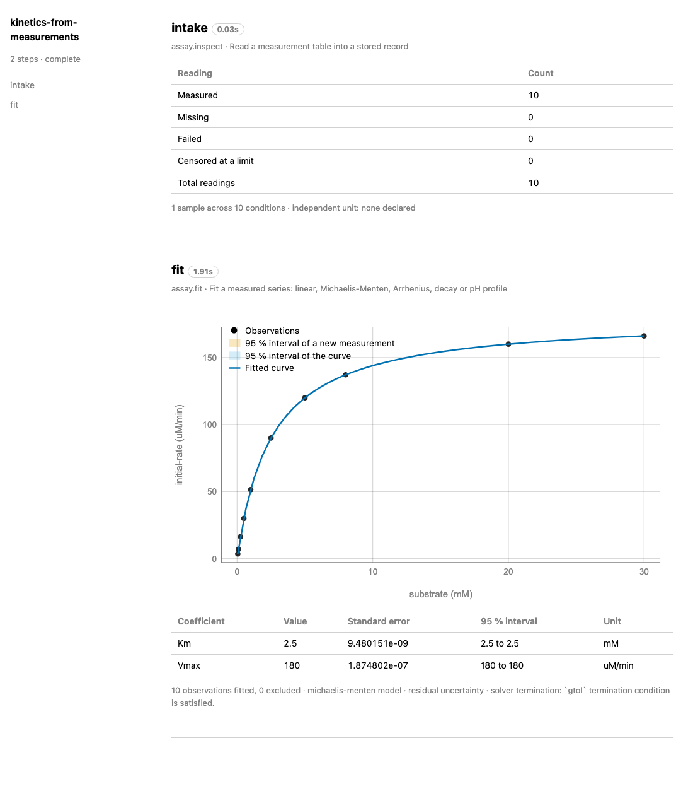
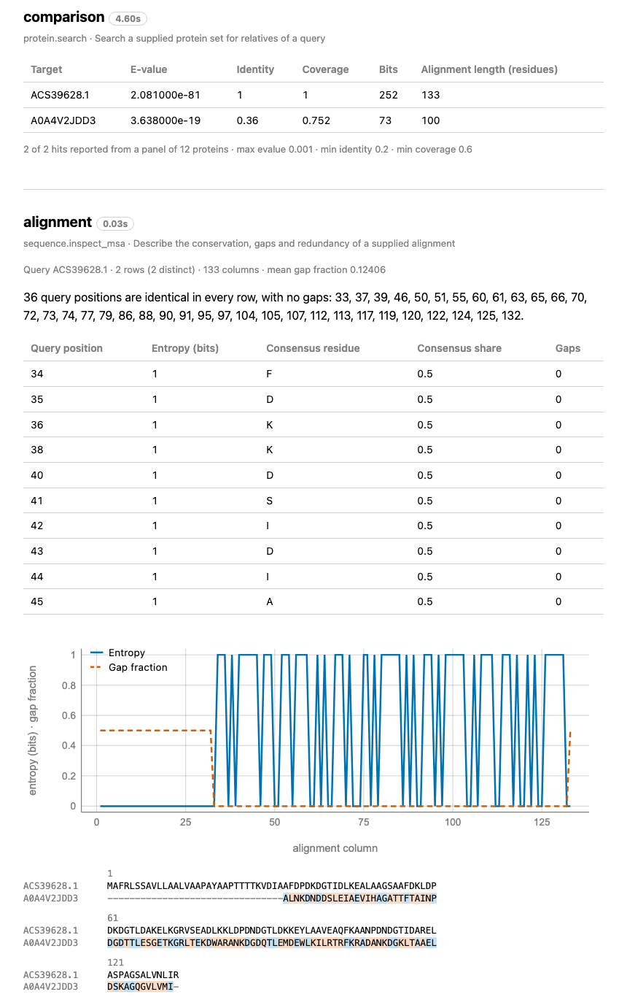

# Alambiq

Alambiq is software that runs computational methods for biotechnology as capabilities.
A campaign, written in YAML or Python, lists steps, and each step runs one capability.
A capability that runs scientific software does so in a pinned engine environment, and one
that needs models or databases declares them as pinned resources. A report is one HTML file;
`alambiq run --report PATH` writes it. The terms are defined in
[Concepts](docs/concepts.md).

Version `0.1.0`. The code, documentation and configuration written for
Alambiq are [Apache-2.0](LICENSE). Optional software, models and datasets are licensed
under their own terms ([LICENSING.md](LICENSING.md)).

## Capabilities

Capabilities are grouped in families (`alambiq capability list` shows the family of
each):

- **Characterize:** protein inspection, search, alignment, profiles, embeddings,
  substitution scoring, stability-change prediction, secondary-structure and
  function-region prediction, protein completion, enzyme candidate retrieval, structure
  prediction, genomic context.
- **Investigate:** reactions and routes, thermodynamics, enzyme-panel evaluation of
  activity prediction, structure comparison and preparation, binding pockets, molecular
  dynamics, metadynamics, trajectory and replica analysis, relative binding free energy,
  QM/MM and reaction free energy.
- **Engineer:** candidate fitting and selection, variant proposal, construct design
  and assembly, coding-sequence recoding.
- **Measure:** measurement intake, fits, and the conversion and activity that a batch
  product target requires.
- **Operate:** definition of rate parameters from measured kinetics, reaction
  simulation, fitting, uncertainty propagation, comparison with measurements, output
  accounting and comparison of input costs.

```bash
alambiq capability list
alambiq capability show assay.fit
```

The first command prints every capability. The second prints the request fields, the
result, the method and the limits of `assay.fit`.

## Reports

`alambiq run --report PATH` writes a report: one HTML file that lists each step with its
result. The first image shows the report of
[kinetics-from-measurements](examples/kinetics-from-measurements/README.md): a table of the
readings and a Michaelis-Menten fit with the interval of the curve. The second image shows
the search and alignment steps of the report of
[lanmodulin-comparison](examples/lanmodulin-comparison/README.md).





## Installation

Install the [core](docs/install.md) in a virtual environment (Python 3.11 or newer) and
run the example:

```bash
python -m venv .venv
.venv/bin/pip install -e ".[quantitative]"
.venv/bin/alambiq run examples/kinetics-from-measurements/campaign.yaml --report report.html
```

The `quantitative` extra installs NumPy, SciPy and scikit-learn. The example fits a
Michaelis-Menten curve to a table of 10 initial rates and writes a report.

Each engine environment contains one of the following scientific packages and the Alambiq
engines that call it: MMseqs2, P2Rank, ThermoMPNN, ESM, OpenMM, Boltz-2, OpenFF, OpenFE,
pymbar, PySCF (QM/MM). Each engine environment except the Apple GPU environment of Boltz-2 is available as a
[Docker image](environments/docker/README.md), and each is available as a native environment
built from a recipe. The [installation guide](docs/install.md) describes both routes and the
pinned resources. `alambiq env check` reports which engine environments are ready, and
`alambiq resource list` reports which resources are installed.

## Documentation

- [Index](docs/README.md): the pages by subject.
- [Getting started](docs/getting-started.md): installation of the core and the first run.
- [Installation](docs/install.md): extras, engine environments, resources, run
  directories and platforms.
- [Concepts](docs/concepts.md): capabilities, families, campaigns, steps, bindings,
  presets, requests, results, records, runs, run records, reuse, engine environments,
  resources and reports.
- [Python interface](docs/python.md): campaigns and capabilities from Python.
- [Examples](examples/README.md): worked examples.
- [Methods](docs/methods/README.md): choosing and reading the capabilities of each method
  area.
- [Reports](docs/reports.md): the contents of a report.
- [Licensing](LICENSING.md): the licenses of Alambiq and of optional software, models and
  datasets.

## Repository layout

- `src/alambiq/core`: the campaign runner.
- `src/alambiq/capabilities`: the capabilities by family, with their scientific
  computation in functions that tests call directly.
- `src/alambiq/engines`: the engines that run inside engine environments.
- `src/alambiq/report`: the report writer.
- `environments/`: the recipes and verification files of the engine environments, and
  the Dockerfiles in `environments/docker`.
- `examples/`: the runnable examples.
- `tests/core`: the test suite (`python -m pytest tests/core`).

Models, engine environments and databases are installed as described in
[docs/install.md](docs/install.md).
